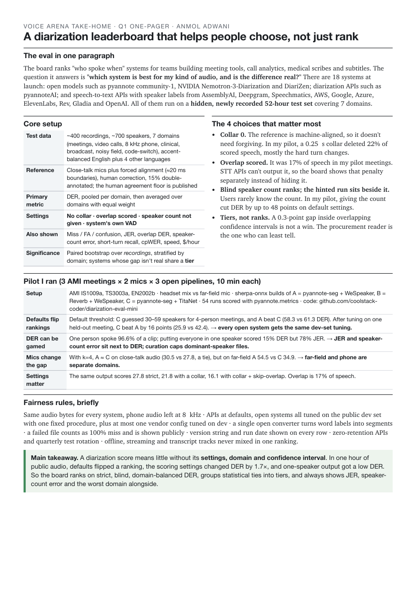
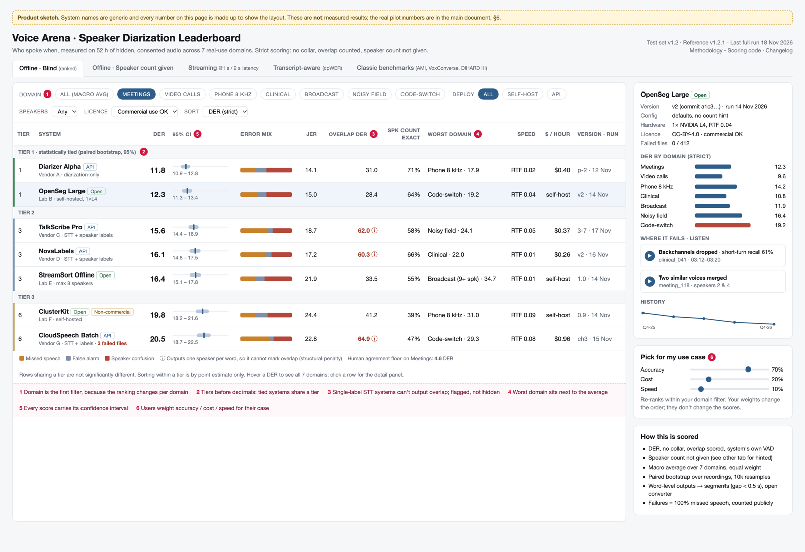
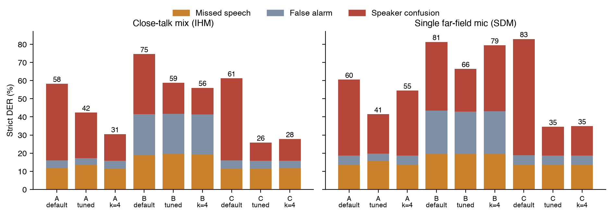
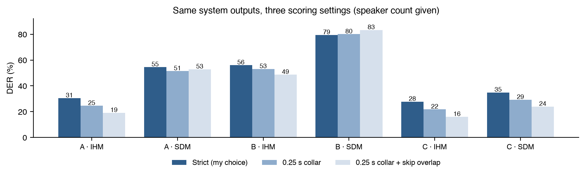

# Speaker Diarization Leaderboard: Eval Design + Pilot

My submission for the **Voice Arena take-home, Question 1**: design how a public leaderboard should evaluate speaker diarization systems ("who spoke when"). I didn't want to only argue for my choices, so I also ran a small version of the eval on real AMI meetings to test them.

| Deliverable | File |
|---|---|
| Main document | [`report/Anmol_Adwani_Q1_Main.pdf`](report/Anmol_Adwani_Q1_Main.pdf) |
| One-page report | [`report/Anmol_Adwani_Q1_OnePager.pdf`](report/Anmol_Adwani_Q1_OnePager.pdf) |
| Leaderboard sketch | [`report/Anmol_Adwani_Q1_Leaderboard_Sketch.png`](report/Anmol_Adwani_Q1_Leaderboard_Sketch.png) |
| Pilot code + results | this repo (`run_systems.py`, `score.py`, `results/`) |

---

## The design in short

- **Who it's for:** teams choosing a system for meeting notes, call analytics, medical scribes or subtitles. Their real question is *"which system works on my kind of audio, and is the gap real?"*
- **Systems:** 18 at launch:
  - open source: pyannote community-1, NVIDIA Nemotron-3-Diarization, Sortformer, DiariZen, 3D-Speaker, WhisperX
  - diarization API: pyannoteAI
  - STT APIs with speaker labels: AssemblyAI, Deepgram, Speechmatics, AWS, Google, Azure, ElevenLabs, Rev, Gladia, OpenAI
- **Test data:** a hidden, newly recorded **52 h** set across 7 domains: meetings, video calls, 8 kHz phone, clinical, broadcast, noisy field and code-switch. The reference is built from close-talk mics and forced alignment, then checked by a second annotator on 15% of files.
- **Primary metric:** DER pooled within each domain, then averaged with **equal weight per domain**.
- **Settings:** **no collar, overlap scored, speaker count not given, system's own VAD**.
- **Ranking:** a paired bootstrap over whole recordings. Systems whose difference isn't significant **share a tier**, instead of getting fake #3/#4 ranks.
- **Always shown beside DER:** JER, the miss / false-alarm / confusion split, speaker-count error, overlap DER, the worst domain, version and run date, speed and $/hour.

<p align="center"></p>

## Leaderboard sketch

How the results would look as a product. The domain is the first filter, statistically tied systems are grouped into tiers, and every score has a CI and an error breakdown.



*Every system name and number in the sketch is a placeholder for layout. The measured numbers are below.*

---

## Pilot: what I actually ran

- **Audio:** AMI test meetings IS1009a, TS3003a and EN2002b, first 10 min each, recorded two ways:
  - close-talk headset mix (**IHM**)
  - single far-field mic (**SDM**)
- **References:** the word-aligned "only_words" RTTMs. I verified they are identical to `pyannote/AMI-diarization-setup`.
- **Systems:** all built with sherpa-onnx 2.0.3 on CPU.
  - **A** = pyannote segmentation-3.0 + WeSpeaker ResNet34
  - **B** = Rev reverb-diarization-v1 + WeSpeaker
  - **C** = pyannote segmentation-3.0 + NVIDIA TitaNet-small
- **Modes:**
  - blind, with the default clustering threshold
  - blind, with the threshold tuned on a *held-out* meeting (ES2004c)
  - speaker count given (k=4)
- **Scoring:** pyannote.metrics 4.2.0 under 3 settings (strict, 0.25 s collar, collar + skip overlap), for **54 scored runs** in total.

### Results (strict DER %, lower is better)

| System | IHM default | IHM dev-tuned | IHM k=4 | SDM default | SDM dev-tuned | SDM k=4 | RTF (CPU) |
|---|---|---|---|---|---|---|---|
| A pyannote-seg + WeSpeaker | 58.3 | 42.4 | 30.5 | 60.5 | 41.4 | 54.5 | 0.12 |
| B Reverb-v1 + WeSpeaker | 74.6 | 58.8 | 56.0 | 81.3 | 66.4 | 79.4 | 0.16 |
| C pyannote-seg + TitaNet | 61.3 | **25.9** | **27.8** | 82.9 | **34.5** | **34.9** | 0.06 |




### What I learned from it

1. **Defaults can flip a ranking.**
   - With the default threshold, C guessed 30–59 speakers for a 4-person meeting.
   - Tuned on one held-out meeting, C went from 61.3 to 25.9 DER.
   - On defaults A beat C; after tuning, C beat A by 16 points.
   - **So every open system on the board gets the same dev-set tuning.**
2. **DER can be gamed.**
   - In TS3003a, one person speaks 96.6% of the first 10 minutes.
   - Putting everyone in one speaker scored 15.0% DER but 78% JER.
   - **So JER and speaker-count error sit next to DER, and test-set curation caps files dominated by one speaker.**
3. **The mic changes the gap.** With k=4, A ≈ C on close-talk audio (30.5 vs 27.8), but on the far-field mic A falls to 54.5 while C holds at 34.9.
4. **Scoring settings change the number a lot.**
   - A 0.25 s collar removes 22% of the scored speech, and collar + skip-overlap removes 41%.
   - The same output scores 27.8, 21.8 or 16.1 depending on the setting.
5. **Something I couldn't fully explain:** B has about 22% false alarm in every mode. It could be the model or my wrapper. That's exactly why the full process has a sanity-review step.

> These absolute numbers are much worse than published ones, because the ONNX port uses simpler clustering and I scored only 10-minute crops. This tests the *method*. It isn't a ranking of these models.

---

## Repo layout

```
report/                 PDFs, leaderboard sketch, HTML sources of the report
prepare_data.py         AMI audio + references from the HF mirror (diarizers-community/ami)
run_systems.py          runs systems A/B/C → runs/<system>/<mode>/*.rttm
calibrate_threshold.py  threshold sweep on held-out ES2004c
score.py                DER / JER with pyannote.metrics, 3 scoring settings
analyze.py              tables + paired bootstrap (1-min chunks and whole recordings)
plots.py                figures in results/
results/                scores.json, tables.md, figures
runs/                   every system output (RTTM) + timing
```

## Reproduce

```bash
python3 -m venv .venv && . .venv/bin/activate
pip install -r requirements.txt
./download_models.sh                  # sherpa-onnx models → models/, AMI test shards → data/hf/
python prepare_data.py                # wav + reference RTTMs from the shards
python run_systems.py                 # blind (default threshold) + k=4
python calibrate_threshold.py         # pick thresholds on held-out ES2004c
TUNED_ONLY=1 python run_systems.py    # blind with tuned thresholds
python score.py && python analyze.py && python plots.py
```

**Note:** pyannote.metrics' `collar` is the *total* width, while dscore's `--collar` is *per side*. So the usual "0.25 s collar" is `collar=0.5` in `score.py`.

— Anmol Adwani
